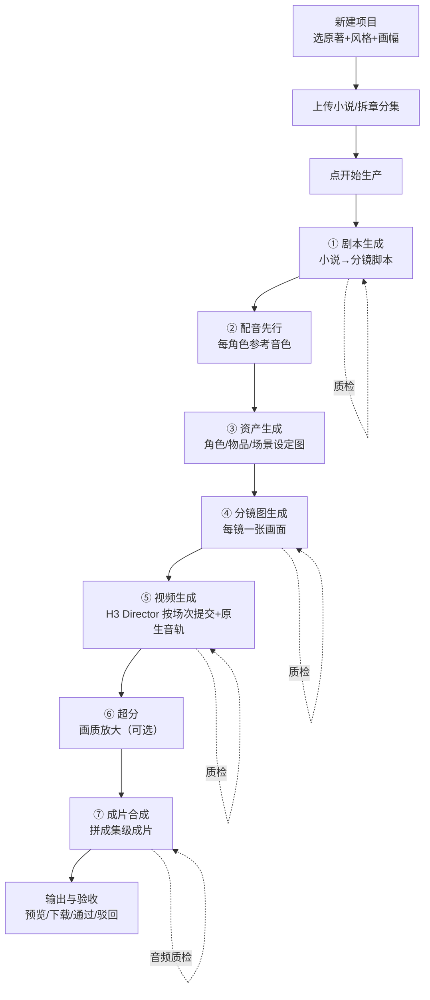

# 漫剧生成系统 · 产品需求文档（PRD）

> 版本：v1.1（代码校正稿）　整理日期：2026-10-16　校正：2026-10-16
> ⚠️ **v1.1 校正说明**：已按 2026-10-16 的代码实测，校正与实现不符的条目（详见 §12 校正记录）。**凡本稿与代码不一致处，以代码为准。**
> 定位：**产品需求文档（PRD）**，聚焦**核心生产链路**
> 来源：本文件是对项目现有资料（`docs/` 下系统设计、需求追溯、竞品对比、UI/UX 契约、审计与交接报告，以及 `app/` 源码现状）的**整合与收敛**，不引入新的产品设想。
> 说明：每条需求都标注**实现现状**，以便区分「已达成」与「待补齐」。

---

## 0. 一句话需求

> **用户把小说上传到程序里，点「开始生产」，程序自动调用本机 ComfyUI 把小说生产成一部可直接发行的短剧视频（成片）。**

系统要做的，是把「一部小说」变成「一集成片」这一整条链路全自动化：拆章分集 → 改编剧本 → 出角色/场景资产 → 出分镜图 → 出视频（含配音与音效）→ 放大 → 合成成片，中间每一步都自带质检与自动返工，最终交付可验收、可下载的视频。

---

## 1. 产品定位与总目标

### 1.1 产品定位

面向**个人/小团队创作者**的**本地化（离线可运行）小说→短剧视频自动生产线**。核心差异化：

- **一句话进、成片出**：输入一部小说，输出整季短剧视频，人只在少数几个决策点介入（选题、风格、验收）。
- **本地算力**：全部生成在本机完成（ComfyUI + 本地模型），不依赖云端算力，保护原著版权与素材。
- **可分发**：项目自包含（工作流、模板、资产随项目走），换机/转交即可运行。

### 1.2 总目标（可拆解的目标）

| 目标 | 说明 | 可衡量的落点 |
|---|---|---|
| **全流程自动化** | 上传小说 → 启动生产 → 自动出片，中途不需要人工逐步点按 | 托管模式下，一集从剧本到成片全自动跑完 |
| **画面与人物一致** | 同一角色跨镜/跨集不换脸、不换发型服装；场景空间连贯 | 角色一致性、跨镜连贯性质检达标 |
| **节奏符合短剧规律** | 固定节拍（**每镜固定 10 秒**，收尾镜可更短）、强冲突、对白驱动、有钩子 | 镜数与整集时长**不设上限**（成片时长 = 镜数 × 10 秒）；覆盖原文情节 |
| **成片可交付** | 有完整音轨（人声 + 音效）、有字幕、有验收留痕 | 成片通过音频质检、可导出/下载 |
| **可复现、可返工** | 单镜/单场出问题时能只重做局部再拼回，不整集重跑 | 单镜返工 → 自动重新合成成片（见 §9 已知缺口） |

> **关于「爆火」**：爆款由**内容选题 + 节奏 + 画质一致性**共同决定，其中选题属人工决策，系统负责把「节奏」与「画质一致性」做到发行级，并对「钩子/冲突密度」给出可检查的量化约束（见 §6 剧本规则）。系统本身不承诺点击率。

### 1.3 使用场景

1. **个人创作者**：手上有一部小说（自有或已授权），想低成本把它做成短剧发到短视频平台。
2. **工作室量产**：一批小说逐本跑，靠托管模式批量出片，人工只做验收与少量返工。

---

## 2. 用户角色

| 角色 | 关心什么 | 系统对应能力 |
|---|---|---|
| 创作者（主用户） | 出片快、画面好看、人物不崩、操作简单 | 一键生产、托管模式、质检报告、单镜返工 |
| 运营/审核 | 成片是否达标、能否交付 | 验收页（通过/驳回 + 原因）、交付物登记、过期标记 |
| 工程/运维 | 环境是否就绪、任务卡在哪、能否复现 | ComfyUI 环境页、日志页、模型就绪检查、状态机 |

---

## 3. 术语表

| 术语 | 含义 |
|---|---|
| **项目（project）** | 一部小说对应的一个生产单元，拥有自己的设定、剧本、资产、成片 |
| **集（episode）** | 生产/交付的最小单位，对应输出一个成片视频文件；一集 ≈ 20~30 镜 |
| **镜（shot）** | 一个镜头，含画面描述、台词、出场角色/物品/场景、时长 |
| **剧本（script）** | 由小说改编出的分镜脚本（JSON），是后续所有生成的依据 |
| **资产（asset）** | 角色/物品/场景的「设定图」，用于锁定外形一致性 |
| **分镜图（storyboard）** | 每个镜头的关键画面（静态图），作为视频生成的首帧/构图基准 |
| **成片（final）** | 一集最终合成的视频文件 |
| **托管（autopilot）** | 自动连续生产模式：按计划逐集自动跑完整条流水线 |
| **自主（autonomous）** | AI 总控根据目标自主决定下一步操作的模式 |
| **质检（QC）** | 用视觉/文本/音频模型对产物打分并判定是否达标 |
| **返工（rework）** | 对不合格的单镜/单场重新生成并替换 |

---

## 4. 端到端主流程

### 4.1 主流程概览

### 4.2 流水线环节（当前代码口径：7 步）

生产流水线固定为 7 个环节（`app/pipeline.py: STEP_SEQUENCE`）：

| # | 环节 | 名称 | 输入 | 输出 | 质检门禁 |
|---|---|---|---|---|---|
| ① | `script` | 剧本生成 | 小说正文 + 设定库 | 分镜脚本 JSON | ✅ 门禁 |
| ② | `tts_pre` | 配音先行 | 剧本的角色表 | 每角色一段参考音色音频 | 否（fail-open） |
| ③ | `assets` | 资产生成 | 角色/物品/场景清单 | 设定图（角色三视图/场景九宫格等） | ✅ 逐项 |
| ④ | `storyboard` | 分镜图 | 剧本镜头 + 资产设定图 | 每镜一张分镜图 | ✅ 门禁 |
| ⑤ | `video` | 视频生成 | 分镜图 + 资产 + 提示词 | 整集视频（含 H3 原生音轨） | ✅ 门禁 |
| ⑥ | `upscale` | 超分 | 集级原片 | 放大后的视频 | fail-open（默认关） |
| ⑦ | `final` | 成片合成 | 视频产物 | 集级成片 | ✅ 音频客观层 |

> 说明：`keyframe`（尾帧）环节已于 2026-10-05 移出主序列（仅保留手动入口）；`tts`（逐句配音）/ `mix`（混音）已下线，因为视频模型自带原生音轨（见 §7.3、§7.5）。
> ⚠️ 2026-10-16 校正：第 ⑤ 步视频**默认按场次提交**（每场一次 H3 提交 + 场间 ffmpeg 拼接），并非「整集一次提交」，详见 FR-22。

### 4.3 生产控制：三种触发方式

| 方式 | 适用场景 | 说明 |
|---|---|---|
| **一键生产（开始/继续生产）** | 主路径，最简单 | 工作台显式 CTA；未开始→开始；进行中→暂停/恢复；失败挂起→处理并继续 |
| **托管模式** | 批量连续出片 | 按生产计划逐集自动跑，可设置集数范围与各项开关 |
| **AI 总控对话** | 需要介入/微调 | 用自然语言驱动（改风格、只重做某镜、查进度…） |

---

## 5. 功能需求（FR）

> 状态标记：✅ 已实现 ｜ 🟡 部分实现 ｜ ⛔ 未实现 ｜ ⚪ 有意不做（产品取舍）

### 5.1 项目管理与入口

**FR-1 新建项目** ✅
- 用户输入项目名、选择原著、选择画风风格、选择画面比例（画幅），创建项目。
- 规则：画风与画面比例必须落盘到项目配置；画幅是后续所有生成的默认值（可被风格串覆盖）。
- 验收：新建后项目出现在项目列表，工作台可就绪。

**FR-2 开始/继续生产入口** ✅（2026-10-12 补齐）
- 工作台必须有显式「开始生产」按钮（不能只依赖 AI 对话触发）。
- 三态：未开始→「开始生产」；进行中→「暂停/恢复」；失败挂起→「处理并继续」。
- 验收：三态 CTA 均可用，点击「开始生产」真正启动流水线。

**FR-3 项目中包含全部所需工作流** ✅
- 项目自带视频/分镜等工作流模板，用户下载/转交项目后可直接运行，不需额外配置外部路径。
- 验收：换机后不依赖原 ComfyUI 安装目录即可解析到模板。

### 5.2 小说上传与分集

**FR-4 上传小说** ✅
- 支持上传小说文本（含 GBK 等中文编码），落盘到小说库。
- 验收：上传后可在项目内看到小说与章节。

**FR-5 章节拆分与分集规划** 🟡（2026-10-16 校正）
- 自动识别章节 → 按**内容体量**决定每章拆成几集：
  - `集数 = ceil(预估成片秒数 / EPISODE_MAX_SEC)`（`EPISODE_MAX_SEC` 默认 7200 秒）；**预估镜数不再是判据**。
  - 超长章按剧情边界切分，切点优先吸附段落/句子边界（`_snap_cut`），**不劈句、不丢字**；
  - 过短章（< 300 字，`CHAPTER_MIN_CHARS`）不拆。
- ⚠️ **默认关闭**：仅 `MJSCXT_EPISODE_SPLIT=1` 时才拆集；默认「一章 = 一集」。
- ⚠️ **「单集 ≤78 镜」红线已废除**：代码不再按镜数硬截断（`MAX_SHOTS_PER_EPISODE=78` 仅为注释性常量）。
- ⚠️ 铁律：**集号 ≠ 章号**（超长章会拆），一切按集反查必须走统一入口，不得用「章号==集号」的假设。
- 证据：`novel_to_script.py:151,4174-4201,4281,4485,4746`；`autopilot.py:551-559,594-598`。
- 验收：开启拆集后，给一章超长文本能拆成多集；文本零丢失。

**FR-6 前置解析与预览** ✅
- 生产前可预览分集方案、跑前置解析（抽取角色/场景/物品），让用户在开跑前确认。

### 5.3 剧本生成（核心）

**FR-7 小说 → 分镜剧本** ✅
- 分块读取小说 → 抽取角色圣经 → 逐块生成镜头（含画面描述、台词、出场角色/物品/场景、景别/运镜、时长）。
- 每镜字段：`camera`（景别）、`camera_motion`（运镜）、`description`、`visual_detail`、`dialogue[]`、`characters_in_shot`、`items_in_shot`、时长等。
- 验收：生成的剧本结构合法、字段齐全、可被后续环节消费。

**FR-8 改编原则＝压缩提炼（非逐句照搬）** ✅（2026-09-27 起）
- 先提炼 3~5 句剧情梗概 → 只保留冲突/转折/关键动作/金句；单镜信息量受限；禁止纯环境空镜。
- **不产出旁白**（旁白通道已关闭）；心理活动改写为角色本人口吻的自语台词。
- 台词驱动：有台词镜占比有下限约束；单镜台词字数有上限，超出要拆镜。
- 验收：剧本不存在大段背景描述散文；无旁白字段。

**FR-9 原文覆盖率约束** ✅
- 覆盖率下限（默认 85%）：保证关键情节不丢，但**纯环境/背景描写不计入考核**（不算遗漏）。
- 未达阈值 → 触发补生成（限 1 轮），避免「为凑覆盖率而生出空镜」。
- 验收：剧本覆盖率 ≥ 阈值；不因覆盖率产生无意义补镜。

**FR-10 时长与镜头粒度** ✅（2026-10-14 用户最终口径）
- **每镜固定 10 秒**（下限与上限同锁 10.0 秒）——消除「模型按内容量把镜头切碎/拉长」的自由度，那正是镜数失控的来源。
- **收尾镜例外**：每场戏的最后一镜允许更短（下限 2.5 秒），因为悬念定格/静态收尾撑不满 10 秒是正常的。
- **镜数与整集时长均不设上限**：一章讲不完就多出几镜，成片时长 = 镜数 × 10 秒，顺其自然。
- ⚠️ 历史教训：放开 5~12 秒弹性后，模型把「内容少的镜就短」误读成「可以多切镜」，镜数从 26 涨到 47 —— **不要回退到弹性时长**。
- 台词预算按镜头时长推算（10 秒 ≈ 40 字；中文语速基准 4 字/秒，硬上限 4 字/秒），超预算要拆镜。
- 提示词中的数值必须由代码常量生成，不得硬编码副本。
- 验收：每镜时长为 10 秒（收尾镜可更短）；台词不超预算、不被成片尾部截断。

**FR-11 跨集连贯性** ✅
- 逐集记录「上集结尾状态」（角色位置/道具状态/情节），注入下一集，保证跨集承接。
- 验收：相邻两集交接处情节不跳跃。

**FR-12 角色抽取口径统一** ✅
- 纯背景路人（无台词、无独立动作）不登记；但**共同推进情节的阵营/敌群/群像必须登记**（有首领登首领，否则登记为一个群像角色）。
- 验收：主角、反派、关键群像都被正确抽取并进入资产流程。

### 5.4 配音先行

**FR-13 每角色参考音色** 🟡（2026-10-16 校正）
- 剧本产出后，为角色生成一段**参考音色**音频，落盘到音色库。
- 用途：视频生成时以「参考音色」锁定角色声音，台词由视频模型按各段自生成（同一角色跨集音色稳定）。
- 该步 fail-open：任何异常只告警，不阻断整集。
- ⚠️ **参考音色槽位硬上限 = 3**（`ref_audio_0..2`）；角色多于 3 时按重要性裁到 3 支并告警——即并非「每个角色」都有（`asset_refs.py:837-847`）。
- 验收：选中的主要角色都有参考音色；生成视频时音色一致。

### 5.5 资产（角色/物品/场景）

**FR-14 角色设定图** ✅
- 生成角色三视图定妆图（含主视觉/面部/配色板/局部细节/比例参照等区块）。
- 角色外形「锁定条款」：角色的发型、瞳色等**不可变特征**写入参考提示词，保证跨镜/跨集一致。
- 验收：同一角色在不同镜头/不同集外观一致。

**FR-15 场景资产（九宫格）** ✅
- 场景按 9 个机位档（全景/远景/中景/近景/两处特写细节/左右 45°/俯视）逐档出图，**按格序定长拼接**成一张九宫格作为场景资产本体。
- 验收：九宫格 9 格齐全，无空黑格，格序不错位。

**FR-16 资产不重画（幂等）** ✅
- 已达标资产不重复生成；仅当用户要求覆盖时才重画。
- 验收：重复跑不产生新图、不覆盖已达标的图。

### 5.6 分镜图

**FR-17 逐镜出分镜图** ✅
- 依据剧本镜头 + 出场角色/物品/场景的设定图，生成每镜画面。
- 参考图**按剧情动态分配**（出场角色每人一张三视图 + 本镜物品 + 场景 + 3D 站位基准图），有槽位上限，超限按「角色→物品→场景」优先级截断。
- 验收：每镜产生一张分镜图；参考图数量随镜头内容变化。

**FR-18 3D 站位/机位基准图** ✅
- 生成分镜前，按镜头景别/机位渲染一张**无头人偶站位基准图**（用于统一构图与站位），作为分镜图的构图基准。
- 降级策略：渲染失败/超时一律静默降级为「只注入文字站位锚点」，**绝不阻断主链路**。
- 验收：有基准图时构图与站位一致；无浏览器/渲染失败时正常降级。

**FR-19 参考图与提示词同源声明** ✅（2026-10-16 校正：R6 已修复）
- 送进模型的参考图必须在提示词里显式声明「哪张图是谁/是什么用途」。
- 已修复：兜底句字面量已从代码移除；参考图标签归一 + 官方身份声明句式（`comfyui_client.py:465-483,4253-4339`）。
- 验收：抽样镜头中，含「身份/外观参考 imageN」声明的比例 ≥ 90%。

**FR-20 分镜生成过程可视化** ✅
- 生成中的分镜图先落在临时目录（`scratch`），**过关才进正式目录**；界面 5 秒轮询显示「生成中」缩略图，可点击放大。
- 验收：生产中界面能看到逐镜进度与生成中画面。

### 5.7 视频生成（ComfyUI 核心）

**FR-21 调用本机 ComfyUI 出视频** ✅
- 通过本机 ComfyUI 服务执行视频工作流（MiniMax H3 Director 模板），产出**整集视频**。
- 项目侧负责：构建时间轴（每段时长/参考图/参考音色/提示词）→ 上传参考图/音频 → 提交任务 → 回收成片。
- ⚠️ 默认**按场次提交**（见 FR-22），非「一次提交产出整集」。
- 验收：提交后从 ComfyUI 拿回整集 mp4。

**FR-22 提交粒度：按场次提交 + 场间拼接（默认）** ✅（2026-10-16 校正）
- 视频交付粒度仍是「整集」（逐镜/尾帧模式已废弃）；但**提交粒度默认 = 场**（`MJSCXT_VIDEO_PER_SCENE=1`）：每场一次 H3 提交产出 `scene_NN.mp4`，全部场次完成后**由 ffmpeg concat 拼接成整集**。
- 场内再按 `H3_BATCH_SEGMENTS`（默认 5 段）分批，**批间同样 concat**；H3 段间隐变量只能在同一次提交内传递，故批边界是硬切、且**永远落在场内**（换场点恰在提交边界）。
- 即：段间连续性由模型内部张量传递**仅在同一次提交内成立**；**跨场/跨批是硬切 + ffmpeg 拼接**。
- `MJSCXT_VIDEO_PER_SCENE=0` 可切回旧的「整集一次提交」（此时无逐场拼接）。
- 证据：`video_helpers.py:2156-2163,2624`；`config.py:920-934`。
- 验收：一集产出一个完整 mp4；各场片段拼接后时长守恒。

**FR-23 公共参考参数（跨段一致）** ✅
- 本集**全部分镜都有**的角色/场景/物品图 + 角色参考音色，作为「公共参考」前置到每一段提示词，锁定全片一致性。
- 编号规则：`<Picture N>` / `<Audio N>` 从 1 开始，与内部索引一一对应；音色必须绑定到具体角色名（防串音）。
- 验收：整集同一角色的外观/音色一致。

**FR-24 片段化与时长守恒** ✅
- 整集按时长切成若干段提交；单段时长有上限（`H3_SEGMENT_MAX_SEC`，默认 12 秒，2026-10-11 取消长镜切段）；总时长严格守恒；非末段不写台词原文。
- 验收：总时长与剧本声明一致；无接缝丢失。

**FR-25 原生音轨（人声+音效）** ✅
- 视频模型以「生成」模式产出原生音轨（含对白与背景/打斗音效）；不再走逐句 TTS 合成与后置混音。
- 音色锁定：公共参考音色锁定角色音色，模型按各段台词自生成。
- ⚪ 不做旁白（产品取舍）。
- 验收：成片有可听人声与音效；同一角色音色跨段一致。

### 5.8 超分（画质增强）

**FR-26 集级超分** 🟡（默认关）
- 对整集原片做画质放大（FlashVSR，倍率 2/3/4）；支持「逐场次超分再拼接」与「场内切片超分」。
- fail-open：环境不可用或失败一律记 skipped，**绝不把已跑通的成片拖成失败**。
- 现状：默认关闭（属画质增强，非出片必需）。
- 验收：开启后成片分辨率提升且时长/音轨不变。

### 5.9 成片合成与交付

**FR-27 成片合成** ✅
- 输出集级成片；优先消费超分产物。历史坑：`-shortest` 会静默截尾 —— 已改为**拼接前置校验 + 缺失镜号显式列出 + 允许部分拼接**。
- 验收：成片时长正确、不静默截断；缺失单元有明确提示。

**FR-28 输出与验收** ✅
- 输出页提供：成片预览/下载、按集验收（通过/驳回带原因）、A/B/C/D 状态点、逐镜并排复核。
- **过期态**：上游输入变更后，既有产物标记为「过期」，禁止对旧片盖章，提示「重新渲染该步」。
- 验收：驳回需带原因；过期成片不能验收；通过有留痕。

**FR-29 交付物登记** ✅
- 成片自动登记为交付物，带元信息（存在性、大小、时长）；「过小/时长异常」被视为不完整。
- 验收：合格成片出现在交付清单。

### 5.10 质检（贯穿全链路）

**FR-30 提示词预检（生成前）** 🟡（2026-10-16 校正）
- 出图/出片/送音频**之前**先做确定性质检（骨架完整性/风格声明/参考图用途/台词泄漏/字幕类指令/质量空词等）。
- 三模式：`warn` 只记录 / `repair` 自愈后放行（默认）/ `block` 有 issue 即拦。
- ⚠️ **模式是全局配置**（`prompt_qc_mode(cfg)`），代码中**未按「单镜 vs 批量」区分**——默认 `repair` 下单镜也不会硬阻断。「单镜接口硬阻断 / 批量只自愈」尚未实现（`prompt_qc.py:72-74,1717-1723`）。
- 验收：不合规提示词被拦截或自愈；质检自身故障时 fail-open。

**FR-31 图片质检** ✅
- 用视觉模型对分镜图/资产图打分（角色一致性、构图、风格、是否有文字/水印等）。
- 带设定图比对；3D 无面人偶基准图**永不入质检**（避免臆造缺陷）。
- 验收：不合格图触发重画（上限内）。

**FR-32 视频质检** ✅
- 对视频产物做质量判定（画面花屏/一致性/清晰度等）。
- 验收：不合格触发换种子重跑（上限内）。

**FR-33 音频质检** ✅
- 两层：**客观层**（ffmpeg 解码测静音/电平/时长偏差，零模型依赖、永远执行）+ **AI 层**（频谱/波形图送多模态模型）。
- 整轨口径（成片/整集）必须关闭「有声占比」判定（成片天然有留白）。
- 单向收紧：客观层判死的 AI 层翻不回来；致命时短路不调 AI（省钱）。
- 验收：静音段/无音轨成片被拦；正常留白不误报。

**FR-34 质检教训闭环** 🟡（2026-10-16 校正）
- 质检不达标 → 沉淀为「教训」→ 后续生成时召回并写入提示词（防同类缺陷复发）。
- 现状：链路已通；**去重已修**（`prompt_memory.py:936-969`）；**视频侧**首建已召回（`_apply_video_lessons`）。**残留**：**分镜侧**首建提示词仍不召回历史教训，仅在重试/软放行分支召回（`storyboard_helpers.py`）。
- 验收（目标）：同类建议不重复出现；**分镜**新镜头首次生成即参考历史教训。

**FR-35 质检结论如实** ✅（2026-10-16 校正：已修复）
- 质检结论分三态：**通过 / 软放行（记录问题但不阻塞）/ 硬阻断**。
- 已修复：软放行不再计入 `success`，manifest / API / UI 三处同源按三态区分，并带运行时回归断言（`storyboard_helpers.py:459-509,642-745,3106-3153`；`routes/storyboard_api.py:168-245`）。
- 验收：软放行不计入「成功」，交付面按三态区分显示。

### 5.11 返工与重拼

**FR-36 单镜返工** 🟡（2026-10-16 校正）
- 用户可对单个镜头重新生成分镜图/视频；批量返工有数量上限（≤12 镜）；场次级可「重做本场」。
- 现状：基础设施已落（`seg_map.json` 场次映射 + 单镜回灌场片 + 成片/超分失效标记）。**单镜场**可「返工 → 回灌 → 重拼」；但**多镜场**（剧情常态）与**整集模式**（`MJSCXT_VIDEO_PER_SCENE=0`）下无法只替换单镜，仅登记 `needs_scene_rerun`、保留旧成片；且返工接口**不触发 `step_final`**，交付成片 mtime 可能不变。
- 证据：`video_helpers.py:388-584,2236-2280,899-954`；`pipeline.py:3278-3298,1967-1997`。
- 验收（目标）：多镜场/整集模式下返工 → 自动整场重画 + 重拼 → 交付成片 mtime 更新；返工中的状态可见。

**FR-37 分段导出（只替换坏段）** ⛔（2026-10-16 校正）
- 目标：生成即按段落盘，可只替换出问题的段再拼回。
- 现状：段级重拼分支仍在，但**默认 `export_mode="all"`**（`comfyui_client.py:5675,5696-5700`），默认只落 `scene_NN.mp4`、无 `seg_NNNN.mp4`；段级路径仅当显式 `MJSCXT_H3_EXPORT_MODE=segments` 才可达。（注：段映射表 `seg_map.json` 现在**默认会落盘**，但内容为场次映射。）
- 验收（目标）：跑一集后段文件与段映射表存在；返工段只占对应段位。

### 5.12 生产控制与可观测

**FR-38 暂停/恢复/中止** ✅
- 暂停在步骤边界生效；为避免打断在飞的 GPU 渲染（会留半成品），中止检查点只加在「还没产出文件」的位置（LLM 请求前、重试退避前）。
- 验收：暂停后不发起新的 HTTP 请求；不打断在飞渲染。

**FR-39 断点续跑** ✅
- 每个生成 worker 跳过已存在且合格的产物；跨重启可续跑。
- 验收：中断后重跑不重复生成已达标产物。

**FR-40 进度可见** ✅
- 视频阶段按「第 N/M 场」上报；分镜阶段以「临时目录文件增长」判定进度（不信任百分比）。
- 验收：界面能看到当前集/步骤/场次。

**FR-41 失败恢复** ✅
- 托管失败时挂起并保留数据，界面给出「失败集/原因/一键恢复」。
- 验收：失败挂起横幅可见且可恢复。

### 5.13 环境与运维

**FR-42 ComfyUI 环境页** ✅
- 检查 ComfyUI 是否在线、模型是否就绪、TTS/超分环境是否可用。
- 验收：环境缺失时有明确导致与指引。

**FR-43 桌面端与可分发** 🟡
- 提供 Electron 桌面应用；打包后需保证「源码/打包输入/安装区/运行镜像」四处一致才生效（运行镜像才是服务实际加载的那份）。
- 验收：打包哈希门禁通过；桌面版行为与源码一致。

---

## 6. 关键业务规则与硬约束（必须遵守）

这一节是**不可违反的规则**，违反会静默产生错误结果。

### 6.1 集数与镜头

- ~~单集 ≤ 78 镜~~（**2026-10-16 校正：该红线已废除**，代码不再按镜数硬截断；见 FR-5）。
- **集号 ≠ 章号**；按集反查必须走统一入口；**单元编号按全量章节展开**（与「本次选中的章」无关），否则同一章在两条链路上拿到不同集号，产物错位。
- 单镜**固定 10 秒**（收尾镜下限 2.5 秒）；**镜数与整集时长不设上限**（成片时长 = 镜数 × 10 秒）。

### 6.2 提示词

- 视频提示词正文一律英文（骨架英文，中文只作「数据」原样嵌入）；不得写「严禁出现字幕/水印」（反而会画出来）。
- 台词必须写「说话人 + 开口动作」，否则嘴唇不动；一镜一个说话人。
- 资产提示词禁自带风格词（风格统一由程序追加）。
- 提示词数值必须与代码常量同源，禁止硬编码副本。

### 6.3 参考图/音色槽位

- `<Picture N>` / `<Audio N>` 从 1 开始，与内部索引（0 起）严格一一对应。
- 图片总预算与音频总预算都是「公共 + 段级」的**总和**；超限按优先级截断并告警，**不得静默丢弃**。
- 音色必须绑定角色名（generate 模式下多角色同场，否则串音）。
- 参考音色槽位硬上限 = **3**（`ref_audio_0..2`），超出按重要性裁并告警（2026-10-16 校正）。

### 6.4 画幅

- 资产：角色/道具固定 **1:1**、场景固定 **16:9**（按类型写死，不跟随视频比例）。
- 分镜画幅**继承第 1 张参考图**（是全链路画质天花板）。
- 用户选的画面比例（`config.aspect_ratio`）优先于从风格串解析出的比例。

### 6.5 分集/产物目录

- 新增产物目录时必须同步登记到「删项目」覆盖清单，否则删项目会残留。
- 路径越界：一切脚本路径入参必须校验「是否落在输出目录内」。

### 6.6 环境（本机实测）

- ComfyUI 启动参数**必须含 `--disable-pinned-memory`**（否则长跑会因锁定页耗尽而崩）与 `--vram-headroom 1.0`。
- 显存紧张（8GB）：竖屏大序列有已知崩溃点，需保持特定注意力参数（morton 关闭档）。
- 忙碌时 ComfyUI 的 `/queue`、`/system_stats` 会阻塞（短超时返回 `HTTP=000`），**不能据此判「服务挂了」** —— 用进程存活判定。

---

## 7. 非功能需求（NFR）

| 类别 | 需求 | 现状/约束 |
|---|---|---|
| **硬件** | 在消费级单机上可运行 | 实测环境：RTX 5060 Laptop **8GB 显存** / 32GB 内存；模型经内存分页勉强运行 |
| **性能** | 一集可在可接受时间内跑完 | 单张图 ≈ 45 秒（40 步）；单镜视频 15~20 分钟；**一集（19 镜）为数小时**；这是当前最大瓶颈 |
| **稳定性** | 长跑不崩、断点可续 | 已通过 `--disable-pinned-memory`、`--vram-headroom`、断点续跑、worker 级 skip-existing 缓解 |
| **可观测** | 卡在哪、为什么失败一眼可见 | 有日志页、实时执行流、质检报告、失败横幅 |
| **可复现** | 结果可复现、可追溯 | 产物落盘 + 工作流哈希指纹；生成端 worklflow/模板随项目走 |
| **离线** | 本地运行、不依赖云算力 | 生成全本地；仅 LLM/质检用网关 API（可配置） |
| **可分发** | 项目自包含 | 工作流/模板纳入项目目录；换机可用 |
| **安全** | 密钥加密存储 | 密钥 Fernet 加密落盘；不暴露明文 |
| **国际化** | 中英双语文案 | 已有 i18n 框架；硬编码中文仍在分批迁移 |

### 7.1 性能画像（供规划参考，实测）

- 单张图（资产/分镜同速）：40 步 × ≈0.9 秒/步 ≈ **45 秒**；VLM 质检中位 ≈5 秒；3D 基准图 ≈1.5 秒。
- 分镜慢的本质：**每镜 1 次渲染 + 质检 + 最多 3 轮重试，× 20~30 镜串行**。
- 视频：单段一采 + 二采为分钟级；单镜 15~20 分钟；整集数小时。

---

## 8. 验收标准（可判定）

| 需求 | 验收观察 |
|---|---|
| FR-1/2 新建+开始 | 新建项目 → 工作台出现「开始生产」→ 点击后流水线开始跑 |
| FR-5 分集 | 超长章拆成多集（预估按成片秒数 / `EPISODE_MAX_SEC`）；原文零丢失 |
| FR-8 改编 | 剧本无大段背景描述；无旁白字段；有台词镜占比达标 |
| FR-9 覆盖率 | 覆盖率 ≥ 85%；无因覆盖率产生的空镜 |
| FR-10 粒度 | 每镜 10 秒（收尾镜可更短）；镜数/时长不设上限；台词不超预算 |
| FR-17/18 分镜 | 每镜一张图；有基准图时站位一致；无浏览器时正常降级 |
| FR-21/22 视频 | 从 ComfyUI 拿回整集 mp4；总时长与剧本一致 |
| FR-23 一致性 | 同角色跨镜/跨集外观一致；音色一致 |
| FR-25 音轨 | 成片有可听人声与音效 |
| FR-27 成片 | 时长正确、不静默截断；缺失单元有提示 |
| FR-28 验收 | 驳回需带原因；过期成片不能验收 |
| FR-33 音频质检 | 全静音成片被拦；正常留白不误报 |
| FR-36 返工 | 返工 → 成片更新（**当前不达标**，见 §9） |
| FR-39 续跑 | 中断重跑不重复生成已达标产物 |
| FR-43 桌面 | 打包哈希门禁通过 |

---

## 9. 已知限制与风险（诚实清单）

> 这部分是**当前真实短板**，来自项目内的需求追溯与审计报告，供排期决策。

| # | 项 | 性质 | 说明 |
|---|---|---|---|
| 1 | **多镜场/整集模式下返工不自动重拼** | 🟡 缺口 | 单镜场已可回灌重拼；多镜场与整集模式仅登记 `needs_scene_rerun`，且返工接口不触发 `step_final`（见 FR-36） |
| 2 | **段级导出不可观测** | ⛔ 缺口 | 段级分支需显式 `MJSCXT_H3_EXPORT_MODE=segments`；默认无段文件（见 FR-37） |
| 3 | **分镜首建不召回历史教训** | 🟡 | 视频侧已修；分镜仅在重试/软放行分支召回（见 FR-34） |
| 4 | **面板雷同/构图复刻** | 🟡 | 提示词层已优化（+20pp），同机位/同动作微位移残差仍在，最终通过率约 63%，未达 90% |
| 5 | **生产速度** | ⚠️ | 一集数小时（分镜单镜中位 343.6s × 46 ≈ 4.4h 为主体）；8G 显存下内存换页是最大瓶颈 |
| 6 | **多副本漂移** | ⚠️ | 源码 vs 打包副本已实际漂移（`pipeline.py` 3602 vs 3554 行）；`sync_copies.py` 原为空占位（2026-10-16 已实现） |
| 7 | **「改了没生效」** | ⚠️ | 进程不热加载 + 桌面版资源镜像机制，改代码后需正确重启/重打包才生效 |
| 8 | **单一视频后端** | ⚪ | 强耦合 ComfyUI + H3 模板，换模型成本高（多供应商适配层用户已排除） |
| 9 | **回退成本** | ⚠️ | 集号规则一旦改动，已有产物全部错位，必须清掉重跑 |

---

## 10. 优先级建议（按用户价值 × 缺口）

| 优先级 | 需求 | 理由 |
|---|---|---|
| **P0** | FR-36 返工自动重拼（多镜场 + 整集模式 + 触发 final） | 用户直接点名；当前不可达，返工白做 |
| **P1** | FR-34 分镜首建教训召回 | 改动面小，直接降低同类缺陷复发 |
| **P1** | FR-20 分镜构图残差 | 通过率天花板 63% → 目标 90% |
| **P2** | 生产提速：内存升级 + 分镜提示词增强策略 + 内存护栏 | 「一集数小时」是量产最大障碍 |
| **P2** | 工程地基：多副本同步门禁 + 静态检查门禁 | 一切改动的前置（见优化规划 Phase 0） |
| **P3** | FR-37 段级导出租盘 / FR-30 单镜硬阻断 | 依赖 P0 落地后收敛 |

---

## 11. 附：模块与代码地图

| 领域 | 主要位置 |
|---|---|
| 流水线编排 | `app/pipeline.py`（`STEP_SEQUENCE` / 步骤 runner / 质检门禁 / 断点续跑） |
| 小说→剧本 | `app/novel_to_script.py`、`app/continuity.py`、`app/coverage.py` |
| 资产 | `app/asset_prompt_kit.py`、`app/asset_library.py`、`app/sheet_split.py`、`app/scene_grid.py` |
| 分镜图 | `app/comfyui_client.py`（提示词构建）、`app/te_3d_render.py`（3D 基准图） |
| 视频 | `app/h3_director_builder.py`（时间轴）、`app/comfyui_client.py`（提交/回收）、`app/h3_prompt_kit.py`（提示词） |
| 配音/音色 | `app/tts_client.py`、`voice_bank` |
| 质检 | `app/prompt_qc.py`（提示词预检）、`app/qc_client.py`（图/视频/音频 VLM）、`app/audio_qc.py`（音频客观层）、`app/prompt_memory.py`（教训库） |
| 托管/自主 | `app/autopilot.py`、`app/agent_core.py` |
| 交付 | `app/export_manager.py`、`app/project_store.py` |
| 后端接口 | `app/app.py` 与 `app/routes/*.py` |
| 前端 | `frontend/src/`（React + TS + Vite，产物 → `app/static`） |
| 桌面端 | `electron-app/` |
| 设计/审计文档 | `docs/`（系统设计、需求追溯、竞品对比、UI/UX 契约、审计与交接报告） |
| 优化规划 | `docs/优化规划_PRD落地路线图_20261016.md`（按本稿校正后的分阶段落地路线） |

---

## 12. 校正记录（v1.0 → v1.1，2026-10-16）

本稿 v1.1 依据 2026-10-16 的代码只读核验，校正了以下与实现不符之处（**以代码为准**）：

| 条目 | v1.0 表述 | v1.1 校正 |
|---|---|---|
| FR-5 | `ceil(镜数/78)`、单集 ≤78 镜 | 判据改为 `ceil(秒数/EPISODE_MAX_SEC)`、默认关闭、78 镜红线废除 |
| FR-13 | 「每个角色」有参考音色 | 槽位上限 3，超限按重要性裁 |
| FR-19 | 🟡 有图无声明 | ✅ 已修复（R6） |
| FR-21/22 | 整集一次提交、不做 ffmpeg 拼接 | 默认按场次提交 + 场间/批间 ffmpeg 拼接 |
| FR-30 | 单镜硬阻断 / 批量只自愈 | 模式为全局配置，未按调用点区分 |
| FR-34 | 教训召回重复 + 首次不召回 | 去重已修、视频侧首建已召回；**分镜侧首建仍缺** |
| FR-35 | 🟡 交付面被抹平 | ✅ 已修复（三态同源 + 回归断言） |
| FR-36 | 默认模式不可达、无段映射 | 已落 `seg_map.json`；残留为多镜场/整集模式 + 不触发 final |
| FR-37 | 默认不可达、无段映射表 | 段级分支需显式 env；段映射默认已落盘 |
| §6.1 | 单集 ≤78 镜 | 该红线已废除 |
| §9 | 含 FR-35/19 缺口项 | 移除已修项，新增多副本漂移 |

**PRD 漏记、已补记的重要行为**：视频默认按场次 + concat（含 `H3_BATCH_SEGMENTS=5` 分批）；参考音色槽位上限 3；分集开关默认关闭且 `EPISODE_MAX_SEC=7200`；分镜 2026-10-15 改单帧布局、移除九宫格；分镜重试改「编辑式修复」（改图非重画）；3D 站位图超时收紧 120/60→45/20 且 `ENABLE_3D_BLOCKING_IMAGE` 默认 False。

---

## 附：与现有文档的关系

本 PRD 是**整合稿**，不替代以下专项文档（深入细节请查阅）：

- `docs/需求分析_需求-验收-测试追溯链_T20_20261012.md` —— 需求-验收-测试追溯链（R1~R12 逐条判定）
- `docs/需求追溯补登记_R13合并模型_R14开始生产入口_20261012.md` —— 合并模型与「开始生产」入口
- `docs/system_design.md` —— H3 Director 公共参数（跨模块一致性）设计
- `docs/设计_前端UIUX契约_T25_20261012.md` —— 前端信息架构/交互流程/五态规范
- `docs/小说到视频全流程竞品对比.md` —— 与 ViMax/Huobao/ArcReel/penshot 的逐环节对比
- `docs/代码体检报告_20261008.md`、`docs/最终总结与交接_20261009.md` —— 工程现状与坑
